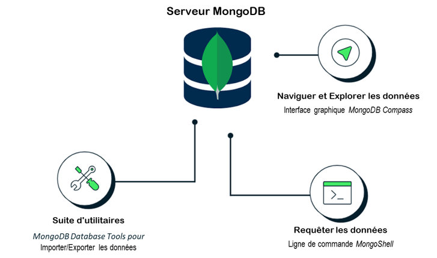
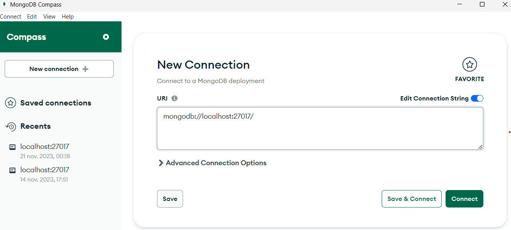
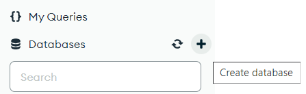

# TP MongoDB : prise en main et pipeline d'agrégation

## Objectifs du TP

L'objectif de ce TP est de mettre en pratique le requêtage de données avec MongoDB.

Le TP est organisé en trois parties :

1. **Prise en main de MongoDB** : installation du serveur sur votre ordinateur, connexion au serveur local et découverte des requêtes de base.
2. **Opérateurs d'agrégation** : découverte de plusieurs étapes du pipeline d'agrégation.
3. **Pipelines d'agrégation** : combinaison de plusieurs opérateurs pour répondre à des questions plus complexes.

> **Compte rendu :** rédigez un compte rendu au format Markdown. Pour chaque question, indiquez la requête exécutée, le résultat obtenu et, lorsque cela est pertinent, une courte explication.

## 1. Installation et préparation de MongoDB

### 1.1. Architecture utilisée

Pour ce TP, chaque étudiant installe et exécute MongoDB directement sur son ordinateur personnel. Le serveur MongoDB, le shell et l'interface graphique sont trois composants distincts :

- **MongoDB Community Server** : le serveur de base de données (`mongod`), qui stocke les données et traite les requêtes.
- **MongoDB Shell (`mongosh`)** : l'outil en ligne de commande qui permet de se connecter au serveur et d'exécuter des requêtes.
- **MongoDB Compass** : une interface graphique facultative qui permet notamment de visualiser les bases, les collections et les documents.



Le serveur local est accessible à l'adresse `mongodb://127.0.0.1:27017`. Le port `27017` est le port utilisé par défaut par MongoDB.

### 1.2. Installer MongoDB Community Server

Téléchargez et installez **MongoDB Community Server** en suivant ce [lien](https://bul.univ-lyon2.fr/index.php/s/MvVMdwQy1cxIF6U/download ), l'édition gratuite du serveur MongoDB. Pour ceux qui n'ont pas Windows choisissez votre système d'exploitation et suivez les instructions officielles :

- [Installation de MongoDB Community Edition (documentation officielle)](https://www.mongodb.com/docs/manual/installation/)
- [Plateformes prises en charge](https://www.mongodb.com/docs/community-platform-support/)

**Important :** choisissez une version stable encore prise en charge. Ne réutilisez pas un ancien installateur téléchargé lors d'un précédent TP. Les écrans et les options peuvent varier selon le système d'exploitation et la version.

#### Sous Windows

1. Depuis la page d'installation, sélectionnez Windows et téléchargez le programme d'installation `.msi` de MongoDB Community Server.
2. Exécutez le programme d'installation et conservez les options par défaut, sauf indication contraire.
3. Lorsque l'assistant le propose, choisissez l'installation de MongoDB comme **service Windows**. Cela permet au serveur de démarrer automatiquement avec le système.
4. Si l'assistant propose d'installer MongoDB Compass, vous pouvez accepter. Compass reste facultatif pour la suite du TP.
5. Terminez l'installation.

Pour vérifier l'état du service, ouvrez l'invite de commandes (`cmd`) et exécutez :

```bat
sc query MongoDB
```

Si le service est démarré, son état doit être `RUNNING`. S'il est arrêté, vous pouvez le démarrer depuis l'application **Services** de Windows (recherchez `MongoDB Server`) ou, dans un terminal ouvert en tant qu'administrateur, avec :

```bat
net start MongoDB
```

Le répertoire d'installation se trouve généralement sous `C:\Program Files\MongoDB\Server\`, mais son emplacement dépend des choix effectués pendant l'installation.

> ⚠️ Si ce n'est pas le cas notez le dans le rendu de votre TP

#### Sous macOS ou Linux

Suivez la procédure officielle correspondant à votre système et à votre gestionnaire de paquets depuis la [documentation d'installation de MongoDB Community Edition](https://www.mongodb.com/docs/manual/installation/).

Après l'installation, démarrez le service MongoDB en suivant les instructions de la documentation correspondant à votre système. Le serveur doit être actif avant de passer à la connexion avec `mongosh`.

### 1.3. Installer MongoDB Shell (`mongosh`)

`mongosh` est le shell en ligne de commande utilisé dans ce TP. Il est distribué séparément du serveur dans les installations actuelles : vérifiez qu'il est bien installé.
- Pour la version windows, nous allons utiliser cette version en suivant ce [lien](https://bul.univ-lyon2.fr/index.php/s/8gRd6y9M6Ge7Fcm/download) 
- Pour les autres [Télécharger et installer mongosh (documentation officielle)](https://www.mongodb.com/docs/mongodb-shell/install/)

Sous Windows, choisissez le paquet **Windows x64 (MSI)**. Sous macOS ou Linux, sélectionnez le paquet adapté à votre système.

Ouvrez ensuite un nouveau terminal et vérifiez l'installation :

```shell
mongosh --version
```

Si le terminal indique que la commande est inconnue, vérifiez que `mongosh` est installé et que son répertoire figure dans la variable d'environnement `PATH`. Fermez puis rouvrez le terminal après une installation ou une modification du `PATH`.

### 1.4. Installer MongoDB Compass 

MongoDB Compass fournit une interface graphique pour explorer les bases de données et les collections. Son utilisation est facultative : toutes les requêtes du TP peuvent être exécutées avec `mongosh`.
- Pour les systèmes d'exploitation windows nous allons partir sur cette version a télécharger en suivant ce [lien](https://bul.univ-lyon2.fr/index.php/s/hOUikbPvoCwGSzQ/download)
- Pour les autres [Télécharger MongoDB Compass](https://www.mongodb.com/try/download/compass)
- [Instructions d'installation de Compass](https://www.mongodb.com/docs/compass/install/)

Une fois Compass installé, lancez-le et utilisez la chaîne de connexion suivante :

```text
mongodb://127.0.0.1:27017
```

Cliquez sur **Connect**. Vous vous connectez ainsi au serveur installé sur votre ordinateur.

### 1.5. Télécharger les données du TP

Téléchargez l'archive contenant les fichiers JSON :

[ Télécharger l'archive R501-mongodb.zip ](https://bul.univ-lyon2.fr/index.php/s/TAZKnCnifPEMafM/download)

Décompressez l'archive dans un répertoire de votre choix. Elle doit contenir les fichiers JSON nécessaires au TP, notamment ceux correspondant aux collections `grades`, `neighborhoods`, `restaurants` et `zips`.

> Conservez le chemin du répertoire dans lequel vous avez extrait les fichiers : vous en aurez besoin pour importer les données.

Ouvrez l'application compass, connectez-vous au serveur localhost. ⚠️ Ne changez pas les paramètres, utilisez le loclalhost et le port par défaut de compass :



Vous êtes désormais connecter au serveur, vous avez sur votre coté gauche les bases de données par défauts et nécessaire de MongoDB.

On va désormais créer une base de donnée, utiliser le boutons (+) à coté de Databases



Nommez la base de données `R501` et créer des collections avec le même nom des fichiers que vous avec télécheger depuis *R501-mondgodb.zip*

### 1.6. Importer les données dans votre serveur local (Facultatif - A ne pas faire)

L'importation en ligne de commande nécessite l'outil `mongoimport`, qui fait partie des **MongoDB Database Tools**. Ces outils sont distribués séparément du serveur dans les versions actuelles.

- [Installation des MongoDB Database Tools](https://www.mongodb.com/docs/database-tools/installation/)
- [Documentation de mongoimport](https://www.mongodb.com/docs/database-tools/mongoimport/)

Installez les Database Tools correspondant à votre système, puis vérifiez que la commande est disponible :

```shell
mongoimport --version
```

Placez-vous dans le répertoire contenant les fichiers JSON décompressés.

**Sous Windows (PowerShell)**, exécutez la boucle suivante. Elle crée une collection par fichier JSON, en utilisant le nom du fichier comme nom de collection :

```powershell
Get-ChildItem -Filter *.json | ForEach-Object {
    $collection = $_.BaseName
    mongoimport --uri="mongodb://127.0.0.1:27017" `
        --db R501 `
        --collection $collection `
        --file $_.FullName `
        --jsonArray
}
```

**Sous macOS ou Linux**, ouvrez un terminal dans le répertoire contenant les fichiers JSON et exécutez :

```shell
for file in *.json; do
    collection="${file%.json}"
    mongoimport --uri="mongodb://127.0.0.1:27017" \
        --db R501 \
        --collection "$collection" \
        --file "$file" \
        --jsonArray
done
```

Ces commandes supposent que les fichiers JSON contiennent chacun un tableau de documents JSON. Si `mongoimport` signale une erreur liée à `--jsonArray`, vérifiez le format du fichier et consultez sa documentation avant de modifier la commande.

**Autre possibilité :** vous pouvez importer les fichiers depuis MongoDB Compass, à l'aide de la fonction d'importation JSON. Dans ce cas, créez d'abord la base `R501`, puis importez chaque fichier dans une collection portant le nom du fichier (sans l'extension `.json`).

### 1.7. Vérifier l'installation et l'importation

Dans un terminal, connectez-vous au serveur local :

```shell
mongosh "mongodb://127.0.0.1:27017"
```

Dans `mongosh`, sélectionnez la base de données du TP et affichez ses collections :

```javascript
[trouver la bonne commande] R501
[trouvez la commande qui permet d'affichez toutes les collections]
```

Vous devez retrouver les collections suivantes :

```text
grades
neighborhoods
restaurants
zips
```

Vous pouvez également vérifier leur présence dans MongoDB Compass, dans la base `R501`.

Pour vérifier que la collection `grades` contient des documents, exécutez :

```javascript
db.grades.countDocuments({})
```

Le résultat attendu pour cette collection est **280 documents**.

> **En cas d'erreur de connexion :** vérifiez d'abord que le service MongoDB est démarré, que `mongosh` est installé et que le serveur écoute sur le port `27017`. Vous pouvez également essayer explicitement :
>
> ```shell
> mongosh "mongodb://127.0.0.1:27017/R501?serverSelectionTimeoutMS=5000"
> ```

## 2. Premières requêtes

Pour cette partie, nous utiliserons les collections `grades` et `zips`.

Dans `mongosh`, la syntaxe générale est `db.<collection>.<méthode>()`, où `<collection>` désigne la collection à interroger (l'équivalent de la table dans une requête SQL) et `<méthode>` désigne l'opération à effectuer.

1. `db.collection.findOne()` : renvoie un document de la collection ([documentation](https://www.mongodb.com/docs/manual/reference/method/db.collection.findOne/)).
   > Pour chacune des collections `grades` et `zips`, récupérez un document et déduisez-en la structure des documents de cette collection.

2. `db.collection.find({})` : récupère les documents de la collection sans les filtrer ([documentation](https://www.mongodb.com/docs/manual/reference/method/db.collection.find/)).
   > Récupérez quelques documents de `grades` et vérifiez qu'ils correspondent à la structure observée à la question précédente.

3. `db.collection.countDocuments({})` : compte le nombre de documents correspondant au filtre fourni ([documentation](https://www.mongodb.com/docs/manual/reference/method/db.collection.countDocuments/)).
   > Donnez le nombre de documents de la collection `grades` (résultat attendu : 280).

4. `db.collection.find({ <champ> : <valeur> })` : récupère les documents dont le champ indiqué possède la valeur spécifiée. Il est possible de spécifier plusieurs champs dans le filtre.
   > Récupérez les documents dont le champ `class_id` vaut `20` dans la collection `grades` (7 résultats).

5. `db.collection.find({ <champ> : { <opérateur> : <valeur> } })` : exprime une condition de sélection sur un champ. Les opérateurs de comparaison sont présentés dans la [documentation des opérateurs de requête](https://www.mongodb.com/docs/manual/reference/operator/query/).
   > Récupérez les documents dont le champ `class_id` est inférieur ou égal à `20`. L'opérateur « inférieur ou égal » se note `$lte` (188 résultats).

6. `db.collection.find({ $expr: { <expression> } })` : permet d'utiliser une expression d'agrégation dans un filtre. Les champs sont référencés avec la syntaxe `"$nomDuChamp"` ou `"$champ.sousChamp"`. Les opérateurs et leur syntaxe sont présentés dans la [documentation des expressions d'agrégation](https://www.mongodb.com/docs/manual/meta/aggregation-quick-reference/#aggregation-expressions).
   > Récupérez les documents pour lesquels `student_id` est supérieur ou égal à `class_id` (188 résultats).

7. Récupérez les documents dont `class_id` est compris entre `10` et `20` inclus (100 résultats). Proposez deux requêtes :
   - une première avec deux conditions sur le champ `class_id` (`$gte` et `$lte`) ;
   - une seconde avec un `$expr` contenant un `$and`.

8. `db.collection.find(<filtre>, <projection>)` : permet de choisir les champs présents dans les documents renvoyés ([documentation sur la projection](https://www.mongodb.com/docs/manual/tutorial/project-fields-from-query-results/)).
   > Affichez tous les documents de la collection en renommant le champ `class_id` en `ue` et le champ `student_id` en `etu`.
   >
   > **Attention :** une projection de `find()` ne permet pas de renommer directement des champs. Utilisez ici une étape `$project` dans un pipeline d'agrégation. La question sert à distinguer la projection de `find()` de celle de l'agrégation.

## 3. Prise en main de quelques étapes d'agrégation

Dans MongoDB, les requêtes complexes peuvent être réalisées à l'aide du [pipeline d'agrégation](https://www.mongodb.com/docs/manual/aggregation/). Un pipeline est une succession d'étapes de transformation appliquées aux documents d'une collection. Il est passé sous forme de tableau à la méthode `db.<collection>.aggregate()`.

Dans cette partie, nous allons étudier séparément plusieurs opérateurs. La syntaxe générale est la suivante :

```javascript
db.grades.aggregate([
    { /* opérateur */: { /* spécification */ } }
])
```

Pour compter le nombre de documents produits par une étape, vous pouvez ajouter une étape `$count` à la fin du pipeline :

```javascript
db.grades.aggregate([
    { /* opérateur */: { /* spécification */ } },
    { $count: "count" }
])
```

1. **`$project`** : sélectionne, supprime ou calcule des champs dans les documents produits ([documentation](https://www.mongodb.com/docs/manual/reference/operator/aggregation/project/)).
   > Affichez tous les documents de la collection `grades` en ajoutant un champ `somme`, dont la valeur est la somme des champs `class_id` et `student_id`.

2. **`$match`** : filtre les documents selon une condition, avec une syntaxe proche de celle de `find()` ([documentation](https://www.mongodb.com/docs/manual/reference/operator/aggregation/match/)).
   > Dans la collection `zips`, récupérez les documents dont la population (`pop`) est supérieure ou égale à `10000` (7 634 résultats).

3. **`$sort`** : trie les documents selon les champs spécifiés ([documentation](https://www.mongodb.com/docs/manual/reference/operator/aggregation/sort/)). Pour chaque champ, `1` indique un ordre croissant et `-1` un ordre décroissant. Par exemple, `{ state: 1, pop: -1 }` trie d'abord par État, puis par population décroissante.
   > Dans la collection `grades`, renvoyez les documents triés par `class_id`, puis par `student_id`, dans les deux cas par ordre croissant.

4. **`$unwind`** : décompose un tableau en produisant un document pour chacun de ses éléments ([documentation](https://www.mongodb.com/docs/manual/reference/operator/aggregation/unwind/)). Le document produit reprend les champs du document initial, mais le champ ciblé contient un seul élément du tableau.
   > Dans la collection `grades`, produisez un document pour chaque élément du tableau contenu dans le champ `scores` (1 241 résultats).

5. **`$group`** : regroupe les documents selon une clé `_id` et permet de calculer des valeurs pour chaque groupe à l'aide d'accumulateurs ([documentation](https://www.mongodb.com/docs/manual/reference/operator/aggregation/group/)). La clé `_id` peut être une valeur simple ou un document construit à partir de plusieurs champs.
   
   Par exemple, le pipeline suivant crée un document par État et calcule la somme des populations :

   ```javascript
   db.zips.aggregate([
       {
           $group: {
               _id: "$state",
               total: { $sum: "$pop" }
           }
       }
   ])
   ```

   > Dans la collection `zips`, donnez, pour chaque ville, la population minimale (16 584 résultats). Pour distinguer les villes qui portent le même nom dans plusieurs États, vous pouvez construire une clé de regroupement composée de `city` et `state`.

6. **`$lookup`** : réalise une jointure avec une autre collection. Les champs `localField` et `foreignField` définissent les champs comparés par égalité ; le champ `as` reçoit un tableau contenant les documents correspondants ([documentation](https://www.mongodb.com/docs/manual/reference/operator/aggregation/lookup/)).
   > Effectuez une jointure entre `grades` et `zips` sur les champs `student_id` et `pop`. Quel est le type du champ ajouté par `$lookup` ? Que contient-il lorsqu'aucun document correspondant n'est trouvé ?

## 4. Pipelines d'agrégation

Dans cette partie, vous allez construire des pipelines en enchaînant plusieurs opérateurs. Avant d'écrire une requête, identifiez les transformations à effectuer. Pour chaque étape, déterminez la structure des documents produits : elle conditionne les champs que vous pourrez utiliser dans les étapes suivantes.

**Exemple :** donner, par ordre de population décroissante, les États ayant plus de 10 000 000 d'habitants.

```javascript
db.zips.aggregate([
    {
        $group: {
            _id: "$state",
            population: { $sum: "$pop" }
        }
    },
    { $match: { population: { $gte: 10000000 } } },
    { $sort: { population: -1 } }
])
```

Répondez aux questions suivantes à l'aide d'un pipeline d'agrégation.

1. Calculer le nombre de notes de chaque type.
   - Indice : commencez par extraire les notes individuellement avec `$unwind`.
   - Indice : vous pouvez compter les occurrences en additionnant la valeur `1` dans chaque groupe.

2. Donner, pour chaque matière, la meilleure note d'examen.

3. Donner les dix villes les plus peuplées.
   - Indice : vous pouvez utiliser l'étape [`$limit`](https://www.mongodb.com/docs/manual/reference/operator/aggregation/limit/).

4. Donner la population moyenne des villes pour chaque État.

5. Donner, pour chaque matière, les étudiants ayant obtenu une note d'examen supérieure à `50`.
   - Indice : vous pouvez utiliser l'accumulateur [`$push`](https://www.mongodb.com/docs/manual/reference/operator/aggregation/push/) dans un `$group` pour constituer une liste.

6. Donner, pour chaque étudiant et chaque matière, sa note générale. La note générale est la moyenne des moyennes obtenues pour chaque type de note. Si plusieurs notes existent pour un même type, calculez d'abord leur moyenne avant de calculer la moyenne générale.
   - Indice : commencez par calculer la moyenne des notes pour chaque étudiant, chaque matière et chaque type de note.

7. Donner, pour chaque matière, le type d'épreuve le mieux réussi. Le type d'épreuve le mieux réussi est celui qui possède la meilleure moyenne, calculée sur l'ensemble des notes de ce type pour cette matière.
   - Indice : vous pouvez calculer la meilleure moyenne avec [`$max`](https://www.mongodb.com/docs/manual/reference/operator/aggregation/max/) tout en conservant l'ensemble des moyennes dans un tableau avec [`$push`](https://www.mongodb.com/docs/manual/reference/operator/aggregation/push/).

## Références et documentation

- [MongoDB Community Edition : installation](https://www.mongodb.com/docs/manual/installation/)
- [MongoDB Shell (`mongosh`) : installation](https://www.mongodb.com/docs/mongodb-shell/install/)
- [MongoDB Compass : installation](https://www.mongodb.com/docs/compass/install/)
- [MongoDB Database Tools : installation](https://www.mongodb.com/docs/database-tools/installation/)
- [Mongoimport](https://www.mongodb.com/docs/database-tools/mongoimport/)
- [Requêtes `find()`](https://www.mongodb.com/docs/manual/reference/method/db.collection.find/)
- [Opérateurs de requête](https://www.mongodb.com/docs/manual/reference/operator/query/)
- [Expressions d'agrégation](https://www.mongodb.com/docs/manual/meta/aggregation-quick-reference/#aggregation-expressions)
- [Pipeline d'agrégation](https://www.mongodb.com/docs/manual/aggregation/)
- [`$project`](https://www.mongodb.com/docs/manual/reference/operator/aggregation/project/)
- [`$match`](https://www.mongodb.com/docs/manual/reference/operator/aggregation/match/)
- [`$sort`](https://www.mongodb.com/docs/manual/reference/operator/aggregation/sort/)
- [`$unwind`](https://www.mongodb.com/docs/manual/reference/operator/aggregation/unwind/)
- [`$group`](https://www.mongodb.com/docs/manual/reference/operator/aggregation/group/)
- [`$lookup`](https://www.mongodb.com/docs/manual/reference/operator/aggregation/lookup/)
- [`$limit`](https://www.mongodb.com/docs/manual/reference/operator/aggregation/limit/)
